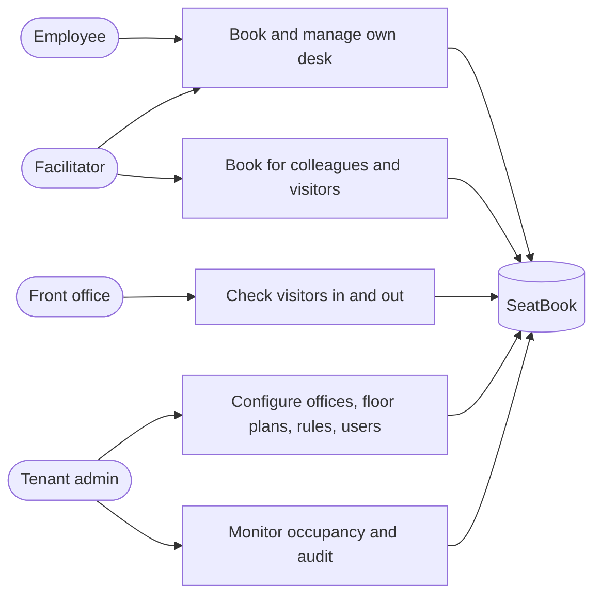

# Introduction to SeatBook

## What SeatBook is

SeatBook is a web application that helps organisations run hybrid offices. Employees reserve a desk for the days they come in, choosing it on an interactive floor plan. Coordinators book for colleagues and visitors. Reception sees who is expected each day and records arrivals and departures. Workplace administrators shape the office layout, set the booking rules, and follow how the space is used.

SeatBook serves several customer organisations from one platform. Each organisation (a *tenant*) works in its own fully separated space, signs in with its own Microsoft identity, and sets its own rules.

## Why it matters

| Business need | How SeatBook meets it |
|---|---|
| People need a guaranteed desk on the days they come in | A desk is reserved for a specific day and cannot be taken by anyone else |
| Facilities teams need to plan space | Interactive floor plans, amenities per seat, blocking of seats, and occupancy views |
| Teams want to meet in the office | Employees see which teammates are in and where they sit |
| Visitors should be expected and welcomed | Visits are registered in advance, with a host and optionally a desk; reception checks them in |
| Each organisation has its own policies | Booking windows and other rules are configured per organisation, without code changes |
| Access must follow the organisation | Sign-in with the corporate Microsoft account; role changes take effect immediately |
| Actions must be traceable | Every significant action is recorded in an audit log |

## Who uses it

*Figure: Who uses SeatBook and for what.*

## Highlights

- **Desk booking on a real floor plan.** Free, booked and blocked seats are shown in colour on the office's own drawing.
- **No double bookings.** Two independent safeguards guarantee one person per desk per day, even when people click at the same moment.
- **Book for others.** Facilitators and administrators book for employees and register visitors in one step.
- **Reception view.** A focused screen for today's visitors with one-click check-in and check-out.
- **Conversational assistant.** A built-in chatbot can book, change and cancel desks in plain language.
- **Corporate single sign-on.** Microsoft accounts, no separate passwords.
- **Organisation-specific rules.** Each tenant sets how far ahead people may book and other policies.
- **Complete audit trail.** Who did what, when, and with what result.
- **Cloud native.** Runs on Amazon Web Services with automated build, test and deployment.

## How this document is organised

| Part | Contents |
|---|---|
| I. Introduction | This overview, users and roles, and a map of capabilities |
| II. Using SeatBook | Step-by-step descriptions of everyday features for employees, facilitators and reception |
| III. Administration | How administrators set up offices, floor plans, seats, users and rules, and oversee activity |
| IV. Technology | Architecture, data, security, integrations, API, quality assurance and operations |
| Appendix | Glossary |
