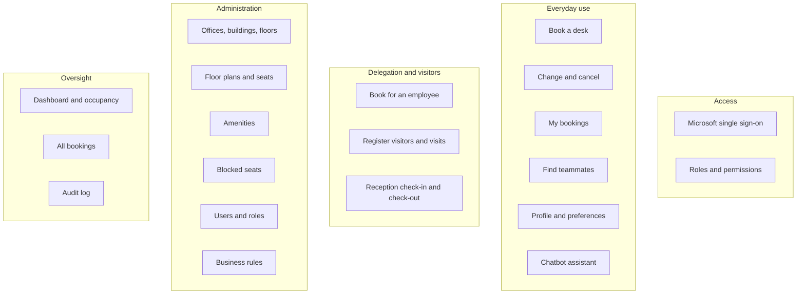

# Capability Overview

## Capability map

*Figure: SeatBook capabilities by area.*

## Capability list

| Area | Capability | Who | Chapter |
|---|---|---|---|
| Access | Sign in with Microsoft, stay signed in securely, sign out | All | 4 |
| Everyday use | Dashboard with today's booking, upcoming days and teammates in the office | Employee, facilitator | 5 |
| Everyday use | Book a desk on the floor plan | Employee, facilitator, admin | 5 |
| Everyday use | Change a booking to another desk or day; cancel a booking | Booking owner, admin | 5 |
| Everyday use | My bookings: current, upcoming, past, cancelled | All who book | 5 |
| Delegation | Book a desk for a colleague, prefilled from their preferences | Facilitator, admin | 6 |
| Visitors | Register visitor profiles; plan visits with host and optional desk | Facilitator, admin | 6 |
| Visitors | Reception view of today's visitors; check-in and check-out | Front office | 7 |
| Assistant | Book, change and cancel through conversation | Employees | 8 |
| Collaboration | See which teammates are in and where; search team members | Employee, facilitator | 9 |
| Profile | Bio, skills, preferred office, floor and amenities | All | 9 |
| Administration | Offices (sites), buildings, floors | Admin | 10 |
| Administration | Amenities and their categories | Admin | 10 |
| Administration | Upload floor plans, configure seats, publish | Admin | 11 |
| Administration | Block seats for a period | Admin | 12 |
| Administration | Users, roles and account status | Admin | 13 |
| Oversight | Dashboard, occupancy by period and location, activity feed | Admin | 14 |
| Oversight | Search and manage all bookings | Admin | 14 |
| Oversight | Audit log with filters and details | Admin | 14 |
| Configuration | Booking windows and other organisation rules | Admin | 15 |
| Notifications | E-mail confirmations for bookings and administrative events | Automatic | 20 |
