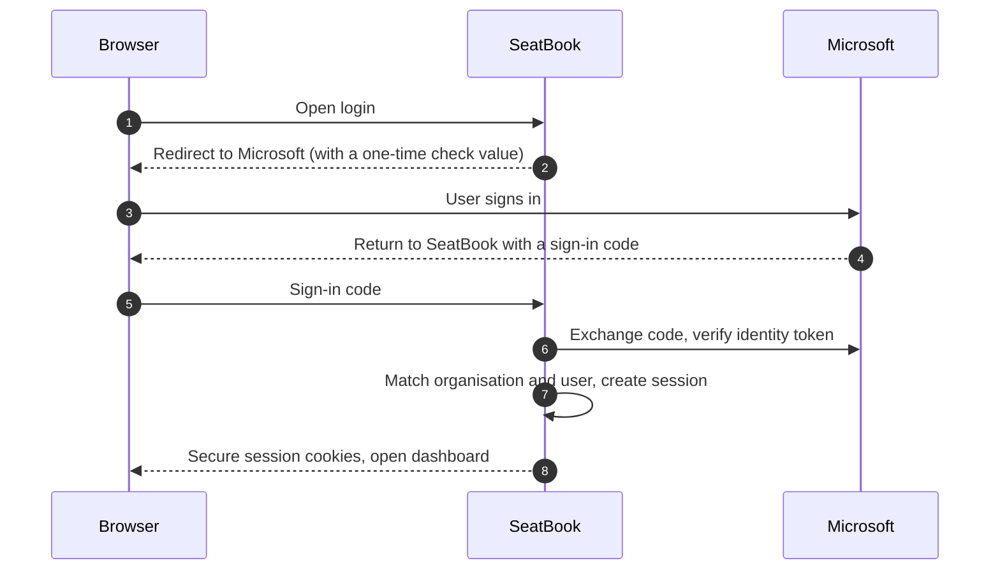
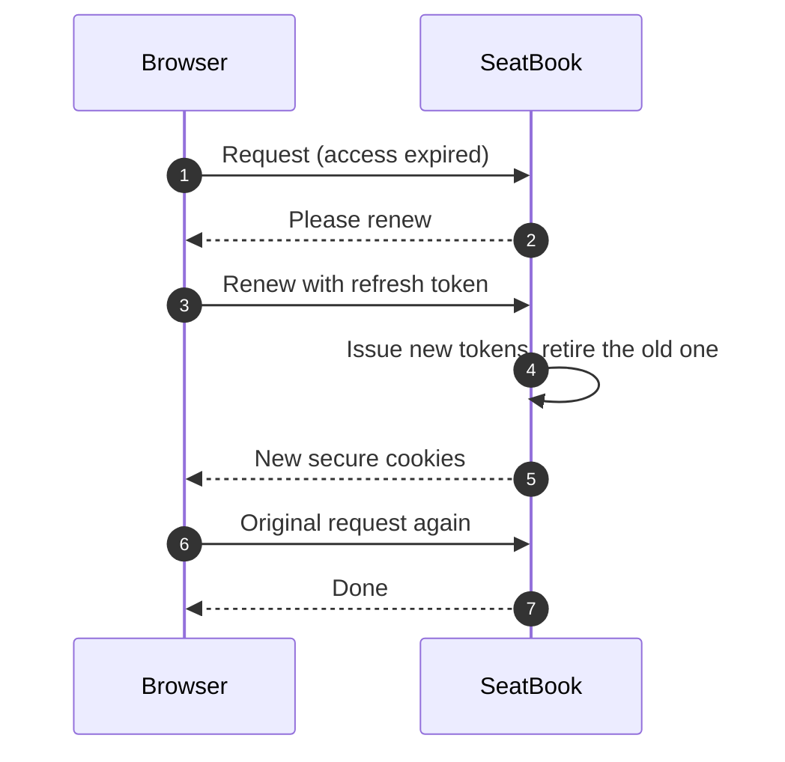

# Signing In

## Overview

Users sign in with their corporate Microsoft account. There is no separate SeatBook password to create, remember or reset. Users from one partner domain sign in through the organisation's SSO gateway; SeatBook recognises their e-mail domain and routes them automatically.

## How it works for the user

1. Open SeatBook. The login page appears.
2. Enter your work e-mail or choose **Sign in with Microsoft**.
3. Sign in at Microsoft as usual (including multi-factor authentication if your organisation uses it).
4. You arrive on your dashboard. SeatBook keeps you signed in while you work.
5. Choose **Sign out** to end the session on that device.

## What happens behind the scenes

*Figure: Sign-in with Microsoft.*

- SeatBook verifies Microsoft's signed identity token and identifies the user's organisation from it.
- A one-time check value protects the return trip from Microsoft against tampering.
- The session lives in secure, browser-protected cookies that page scripts cannot read.
- Short-lived access is renewed silently in the background while the user is active.

## Session and access control

*Figure: Silent session renewal.*

| Feature | Benefit |
|---|---|
| Single sign-on with Microsoft | No new passwords; the organisation's own sign-in policies apply |
| Server-side sessions | Sign-out, role changes and deactivation end access immediately |
| Rotating renewal tokens | A stolen old token cannot be reused; reuse ends the whole session |
| Account and role checked on every request | Access always reflects the user's current status |
| Organisation taken from the verified identity | Users only ever reach their own organisation's data |
| Safe sign-in errors | If sign-in cannot complete, the user returns to the login page with a short error code and no technical details |
