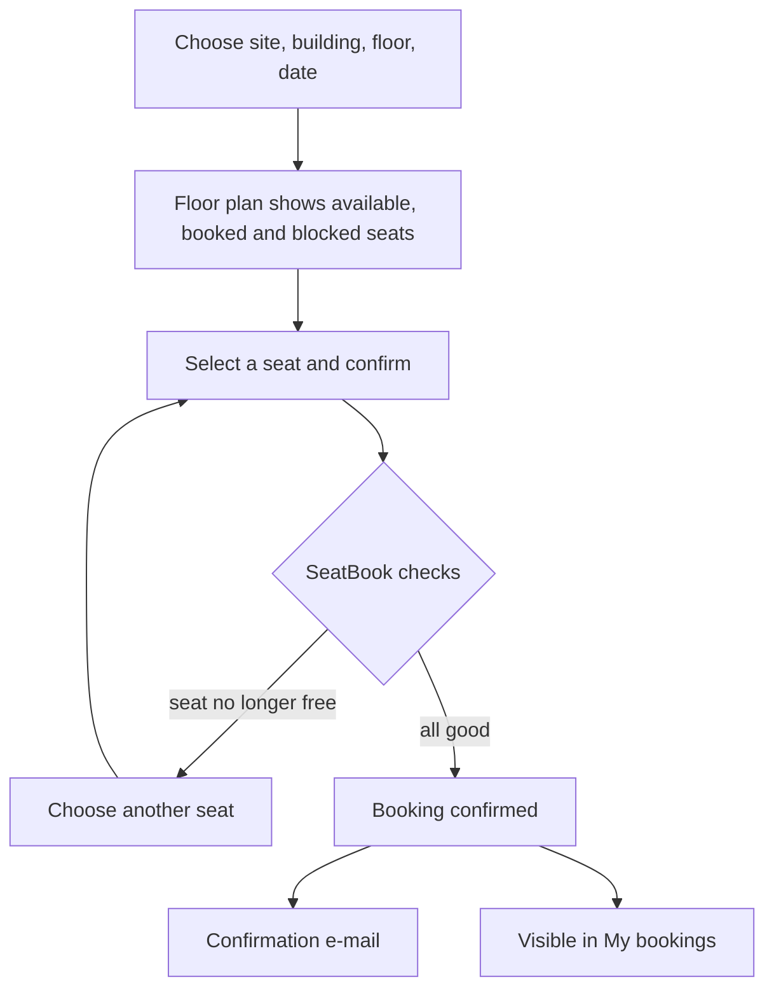
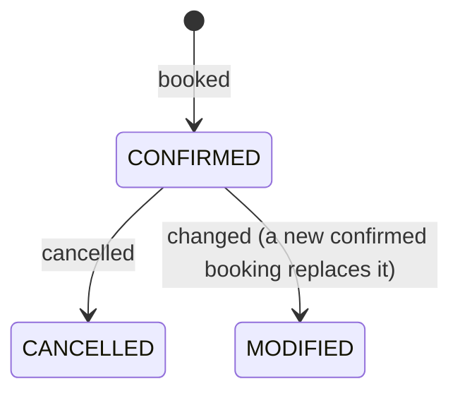

# Booking a Desk

## Overview

Employees reserve one desk for one day on their office's interactive floor plan. They can see all their bookings, move a booking to another desk or day, and cancel it. A confirmation e-mail follows each booking.

## The employee dashboard

After sign-in, employees land on a dashboard that shows:

- today's booking and where to sit;
- upcoming booked days;
- teammates who are in the office today;
- quick links to book or manage bookings.

## Booking step by step

1. Open **Book a space**.
2. Choose the office (site), building, floor and date. The date picker offers only the days the organisation allows.
3. The floor plan appears. Seats are coloured: available, booked, or blocked.
4. Select a seat and confirm.
5. SeatBook checks the request and confirms the booking on screen and by e-mail.

*Figure: Booking a desk.*

## Booking rules

| Rule | Purpose |
|---|---|
| One active booking per desk per day | No two people are given the same desk |
| One active booking per person per day | Everyone holds at most one desk a day, leaving room for others |
| Bookings are for today or a future day | Keeps the plan current |
| Bookings up to a set number of days ahead | Each organisation decides its planning horizon (for example 14 days) |
| Blocked desks cannot be booked | Desks under maintenance or reserved stay unavailable |
| Only active, bookable desks on the published floor plan | People book what actually exists in the office |

## Guaranteed: no double booking

When two people try to book the same desk for the same day at the same moment, SeatBook serialises the two requests: one succeeds and the other is told the desk was just taken. A second, independent safeguard in the database also refuses any duplicate. The result is that a desk is never given twice.

## My bookings

**My bookings** groups bookings into four tabs:

| Tab | Shows |
|---|---|
| Current | Today's booking |
| Upcoming | Future bookings |
| Past | Earlier bookings |
| Cancelled | Bookings that were cancelled |

## Changing a booking

Choose **Change** on a booking, pick a new desk or day on the floor plan, and confirm. SeatBook keeps a full history: the original booking is marked as *modified* and linked to the new one, so it is always clear what changed and when.

## Cancelling a booking

Choose **Cancel** and confirm. The desk becomes available to others straight away. A booking can be cancelled up to and including its day.

## Who can change or cancel

| Person | Can change or cancel |
|---|---|
| The person the booking is for | ✔ |
| The person who made the booking (for example a facilitator) | ✔ |
| A tenant administrator | ✔ any booking in the organisation |
| Anyone else | — |

## Life of a booking

*Figure: Booking states.*
