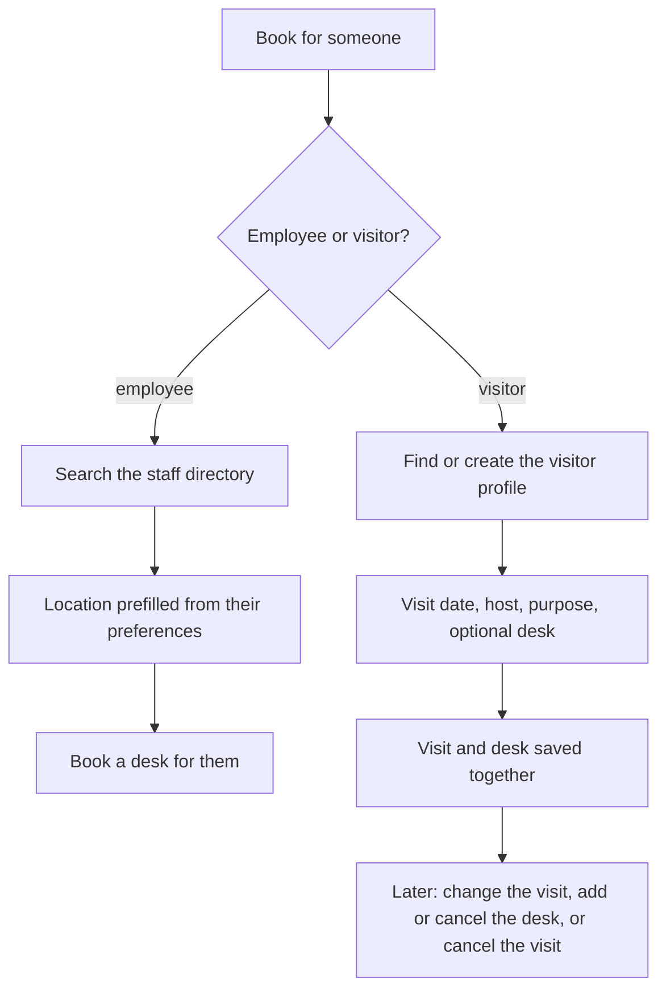

# Booking for Others and Visitors

## Overview

Facilitators and tenant administrators can reserve desks for colleagues and register visitors. A visitor gets a profile, a planned visit with a host, and optionally a desk, all created together.

## Two paths

*Figure: Booking for an employee or a visitor.*

## Booking for an employee

1. Open **Book for someone** and choose *Employee*.
2. Search the staff directory by name or e-mail.
3. SeatBook prefills the colleague's preferred office and floor.
4. Pick a desk and date on the floor plan, then confirm.

The same booking rules apply as for self-booking. The booking shows who made it and who it is for, and appears under *Delegated* in the facilitator's bookings.

## Registering a visitor

1. Choose *Visitor*.
2. Search existing visitor profiles, or create one with name, e-mail, phone and organisation.
3. Enter the visit date, the host and the purpose.
4. Optionally choose a desk.
5. Confirm. The visit and its desk are saved together in one step: either both are recorded or neither is.

## Managing a visit afterwards

| Action | Effect |
|---|---|
| Change the visit only | New date or details; desk unchanged |
| Change visit and desk | Both updated together |
| Add a desk | Reserve a desk for an existing visit |
| Cancel the desk | Visit stays, desk is released |
| Cancel the visit | Visit and any desk are cancelled |

## Visitor information quality

- Phone numbers are stored in international format.
- Each visitor e-mail address is held by one active profile per organisation, so the same visitor is not registered twice.
- Visit dates are planned within the organisation's visitor booking window.

## Benefits

- Coordinators arrange attendance for teams, new joiners and guests in minutes.
- Reception receives an accurate list of who is coming, with host and desk.
- Every delegated booking records both the coordinator and the beneficiary.
