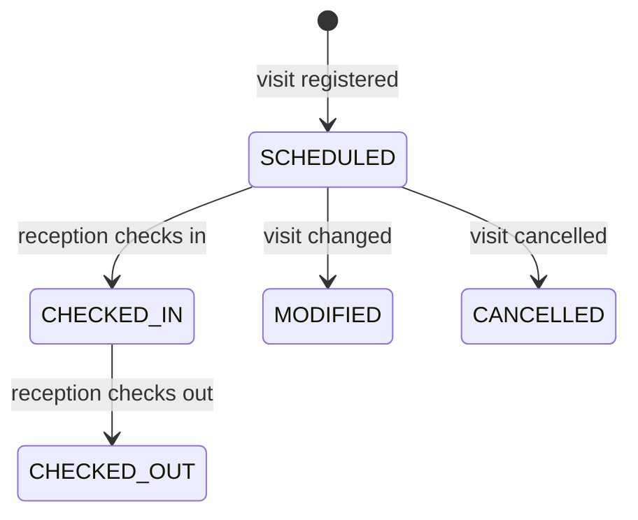

# Front Office: Visitor Arrivals

## Overview

Reception staff have their own dashboard focused on the current day: who is expected, who has arrived and who has left. Checking a visitor in or out takes one click.

## Daily workflow

1. Sign in. The front-office dashboard opens automatically.
2. Select the office (site).
3. The visitor table lists today's visits with host, purpose, desk and status, and summary counts at the top.
4. When a visitor arrives, choose **Check in**.
5. When they leave, choose **Check out**.
6. Open a visitor to see their booking details.

## Visit status

*Figure: Life of a visit.*

## Built-in safeguards

| Safeguard | Benefit |
|---|---|
| Only front office records arrivals and departures | An independent, reliable on-site record; hosts and coordinators cannot mark their own visitors as arrived |
| Reception sees the current day only | Visitor information is shared on a need-to-know basis |
| Each step happens once | A visitor cannot be checked in twice; check-out follows check-in |
| Every action is recorded | The audit log shows who checked each visitor in and out, and when |
