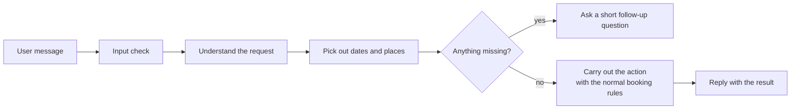

# Chatbot Assistant

## Overview

SeatBook includes a conversational assistant, opened from a floating button on every page. Employees can book, view, change and cancel desks by choosing from menus or typing in plain language, for example *"book a desk tomorrow on floor 3"*.

Each organisation decides whether the assistant is shown to its employees (see Chapter 15).

## What it can do

| Request | Example |
|---|---|
| Book a desk | "Book me a desk next Monday in the main office" |
| See bookings | "What have I booked this week?" |
| Change a booking | "Move tomorrow's booking to floor 2" |
| Cancel a booking | "Cancel my booking on Friday" |
| Get help | Menu of available actions |

## How a message is handled

*Figure: How the assistant processes a message.*

## Design strengths

- **Same rules as the app.** The assistant uses the same booking services as the screens, so availability, permissions and audit records are identical.
- **No extra sign-in.** It uses the user's existing SeatBook session.
- **Predictable.** It is rule-based rather than generative: it understands a defined set of requests and always asks when information is missing.
- **No external AI service.** Conversations stay within SeatBook; sessions and messages are stored per user and organisation.
