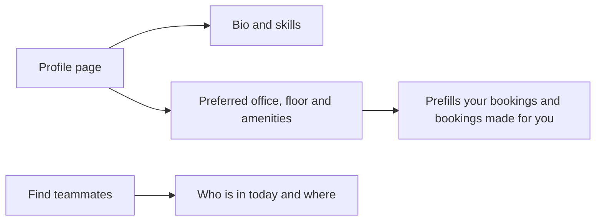

# Teammates and Profile

## Find teammates

Coming to the office is often about meeting colleagues. **Find teammates** shows:

- members of your team and how many are in the office today;
- where each teammate is sitting;
- a search across team members by name.

This makes it easy to choose days and desks near the people you work with.

## Profile and preferences

*Figure: Profile, preferences and teammates.*

| Section | What you can set | Used for |
|---|---|---|
| About me | Short bio and skills | Helps colleagues know who you are |
| Work preferences | Preferred office, building and floor | Prefills the booking screen; facilitators booking for you start from your preference |
| Preferred amenities | For example a second monitor or a standing desk | Helps you and your coordinator choose a suitable desk |
| Booking history | Your past bookings | Personal record |
