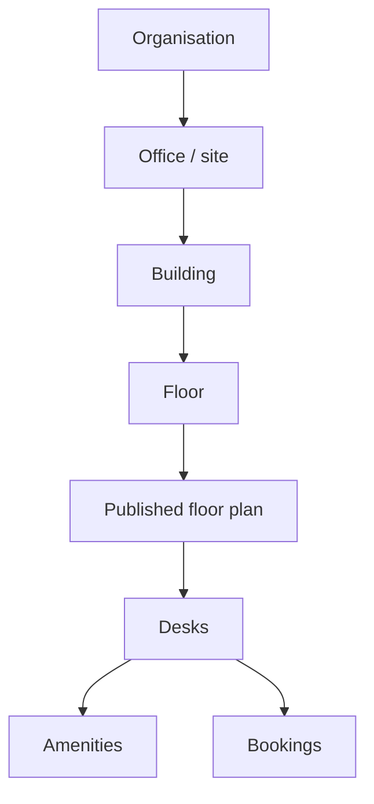

# Offices, Buildings, Floors and Amenities

## Overview

Administrators describe their real estate in SeatBook as a simple hierarchy. Every desk, floor plan and booking belongs to a place in it.

*Figure: The location hierarchy.*

## Managing locations

| Screen | What administrators do |
|---|---|
| Offices | Add and edit sites: code, name, city, country, time zone, status |
| Buildings | Add and edit buildings within a site |
| Floors | Add and edit floors within a building |

Locations can be marked inactive when no longer in use, keeping their history intact. Names are checked for duplicates within their parent location, and every change is recorded in the audit log with the fields that changed.

## Amenities

Amenities describe what a desk offers, such as a docking station, two monitors or a height-adjustable desk. They are grouped into categories.

| Use | Benefit |
|---|---|
| Assigned to desks when configuring a floor plan | Employees see what each desk offers |
| Chosen as personal preferences | Employees and their coordinators find suitable desks faster |
| Shown on the booking screen | Informed choice of desk |
