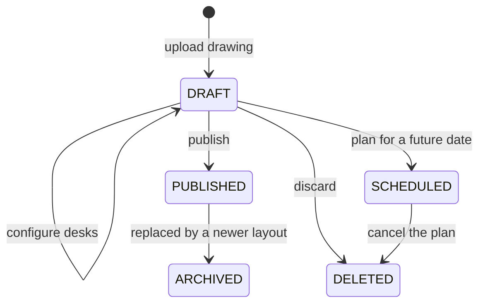

# Floor Plans and Seats

## Overview

Each floor's layout is an SVG drawing, typically exported from the facilities team's own design tools. Administrators upload it, SeatBook finds the desks in it, the administrator configures them, and the plan is published for booking. Layouts are versioned, so the office can be re-arranged without losing history.

## Workflow

1. **Upload.** Choose the office, building and floor and upload the drawing. A preview is shown.
2. **Desks are detected.** SeatBook reads the desk shapes from the drawing and lists them.
3. **Configure desks.** Give each desk its code, mark it bookable or not, and assign amenities, one by one or in bulk.
4. **Publish.** Make the layout live immediately, or prepare it with a planned effective date that respects the organisation's notice period.
5. **Book.** Employees now see and book desks on the new plan.

*Figure: Life of a floor layout.*

## Strengths

| Feature | Benefit |
|---|---|
| Uses the office's own drawing | Employees recognise the real floor; no manual redrawing |
| Automatic desk detection | Fast set-up of large floors |
| Bulk configuration | Codes, bookability and amenities for many desks at once |
| One live layout per floor | Everyone books on the same, current plan |
| Version history | Previous layouts are archived, not lost |
| Notice period for planned changes | Staff get time to adjust to a re-arranged floor |
| Private file storage | Drawings are stored privately per organisation and shown through short-lived secure links |
| Upload notification | Administrators are informed by e-mail when a new layout is uploaded |
