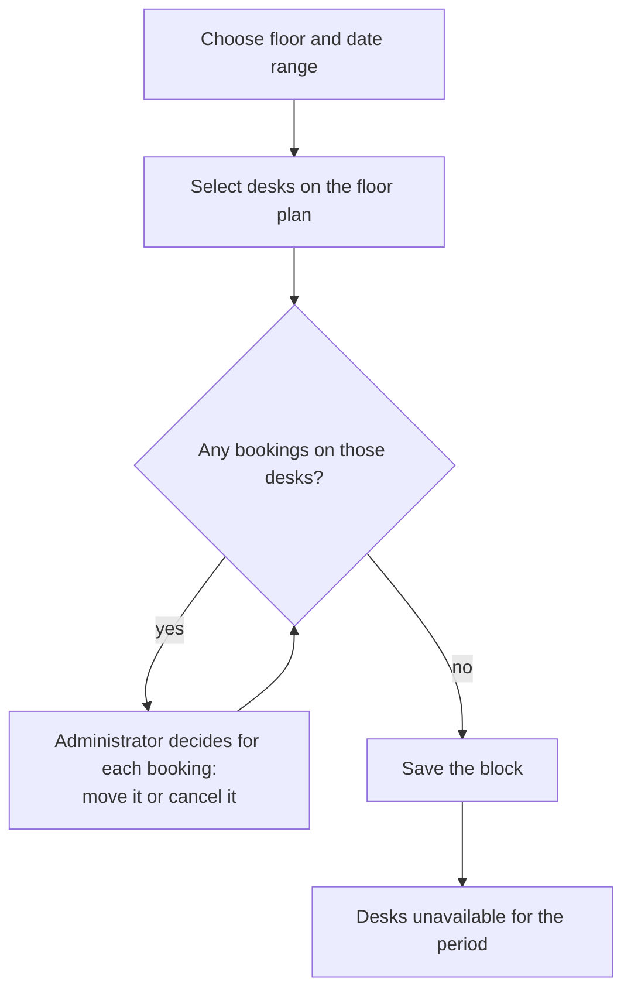

# Blocking Seats

## Overview

Administrators can take desks out of use for a period, for maintenance, an event or a reserved area, without changing the floor plan. Blocked desks are shown as unavailable on the booking screen.

## Workflow

*Figure: Blocking desks without surprising anyone.*

1. Open **Blocked seats → Block** and choose the floor and dates.
2. Select desks on the floor plan.
3. If people have already booked those desks, SeatBook lists the bookings so the administrator can move or cancel each one deliberately.
4. Save. The block becomes active for the chosen period.
5. Edit the dates or end the block early at any time; each block keeps a history.

## Overview screen

Blocks are grouped so administrators see what needs attention:

| Group | Meaning |
|---|---|
| Active | In effect now |
| Upcoming | Starting soon |
| Expiring soon | Ending soon |
| Expired | Recently ended |

The time windows for these groups, and how far ahead a block may start, are organisation settings (Chapter 15).

## Strengths

- **No silent cancellations.** Existing bookings are never overridden without the administrator's decision.
- **Layout aware.** Blocks always refer to desks on the floor plan in force for the period.
- **History.** Every block keeps a record of changes.
