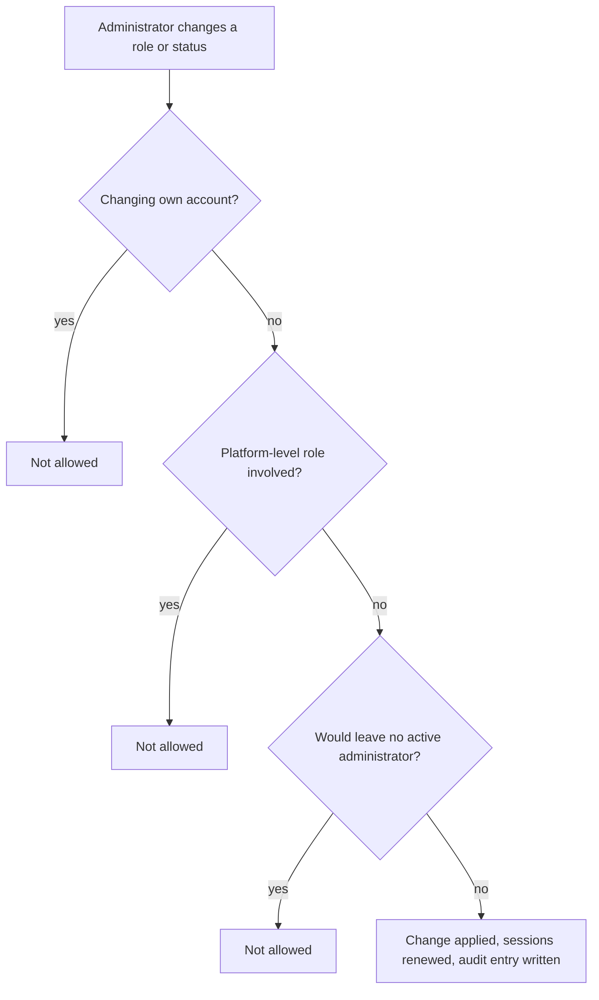

# Users and Roles Administration

## Overview

Users are created automatically the first time they sign in with their Microsoft account. Administrators then manage their role and account status.

## Workflow

1. Open **Users**. Search and filter by role and status.
2. Open a user and choose **Change role**.
3. Select the new role and/or status and save.
4. The change applies immediately: the user's open sessions end and their next sign-in carries the new role.

The **Roles** screen lists the roles and who holds them.

## Built-in protections

*Figure: Safeguards on access changes.*

| Protection | Benefit |
|---|---|
| No self-changes | Administrators cannot raise or lower their own access |
| At least one active administrator | An organisation can never lock itself out |
| Platform roles protected | Organisation administrators cannot assign or alter platform-level roles |
| Immediate effect | Removed access is removed now, not at the next sign-in |
| Full audit | Every change records the before and after values and who made it |
