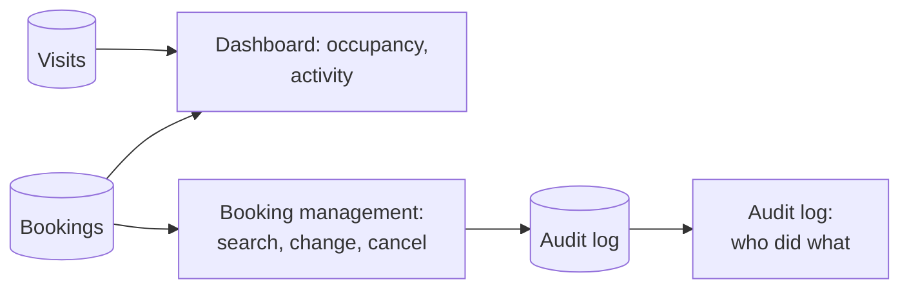

# Dashboard, Booking Oversight and Audit Log

## Overview

Administrators have three oversight tools: a dashboard of occupancy and activity, a searchable list of every booking in the organisation, and the audit log.

*Figure: Data behind the administrator screens.*

## Dashboard

| View | Shows |
|---|---|
| Summary cards | Offices, buildings, floors and desks; bookings and visitors today; desks booked and blocked; occupancy and utilisation percentages |
| Occupancy over a date range | Bookings per day across the chosen period |
| Occupancy by location | Office, building and floor comparison, for example the busiest offices |
| Activity feed | Latest bookings and visits with people and places |

## Booking management

- Search all bookings by date, location, person, desk, status and type (employee or visitor).
- Suggestions while typing names and desk codes.
- Change or cancel any booking, and manage visits, using the same steps and rules as employees and facilitators.

## Audit log

The audit log is the organisation's record of significant actions: sign-ins, bookings, changes, cancellations, visitor check-ins, location and layout changes, blocked seats and access changes.

| Capability | Detail |
|---|---|
| Filters | Action, area, item type, result (success, denied, failure), date range or "last N seconds" |
| Search and sort | Free-text search; sort by time and other columns |
| Detail view | Who, when, from where, what changed (before and after), and a request reference |
| Includes refusals | Attempts that were not allowed are recorded too, not only successful actions |
