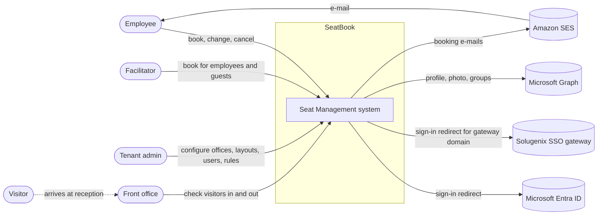
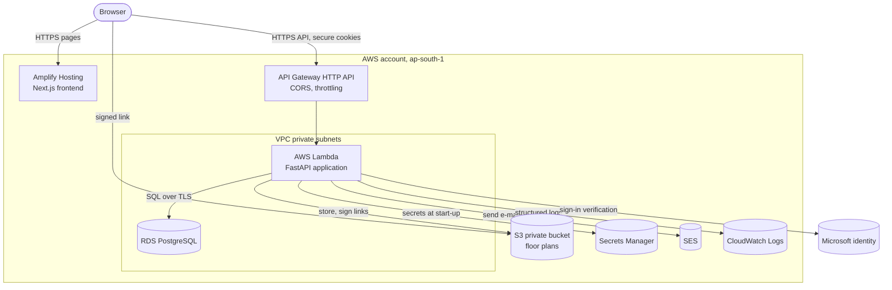
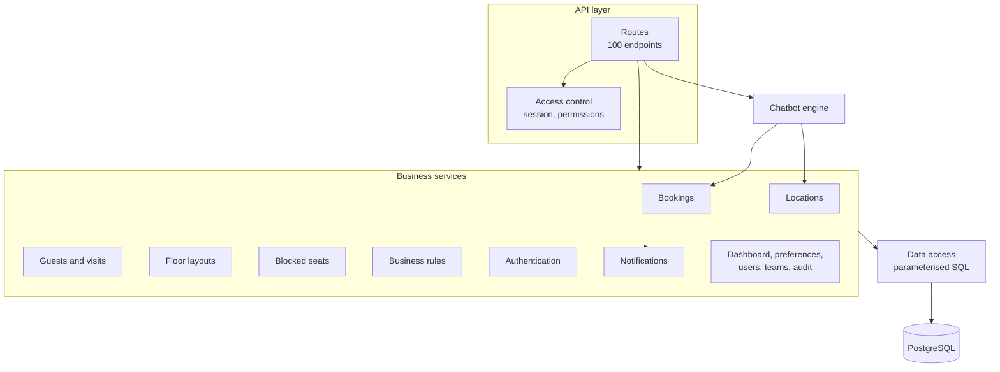
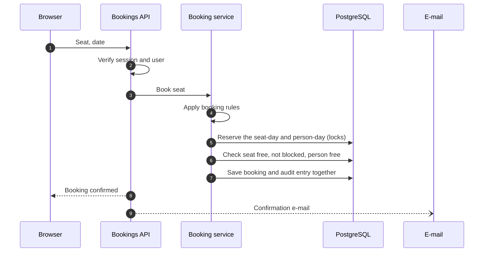
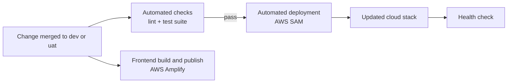

# System Architecture

## Architecture at a glance

| Aspect | Choice |
|---|---|
| Style | Single-page web application with one stateless REST API (modular monolith) |
| Frontend | Next.js 15, React, TypeScript, Tailwind CSS, hosted on AWS Amplify |
| Backend | Python 3.14, FastAPI, PostgreSQL access through parameterised SQL, Pydantic data validation |
| Runtime | AWS Lambda behind Amazon API Gateway (HTTP API) |
| Database | PostgreSQL on Amazon RDS in private network subnets |
| Identity | Microsoft Entra ID single sign-on; organisational SSO gateway for one partner domain |
| Files | Floor-plan drawings in a private Amazon S3 bucket, delivered through short-lived signed links |
| E-mail | Amazon Simple Email Service (SES) |
| Assistant | Rule-based chatbot running inside the API and reusing its business services |
| Multi-tenancy | One platform, many organisations; every record carries its organisation, taken from the verified identity |
| Region | AWS Asia Pacific (Mumbai), `ap-south-1` |

## System context

*Figure: SeatBook and the people and systems around it.*

## Containers

*Figure: Deployed building blocks on AWS.*

| Container | Responsibility |
|---|---|
| Frontend (Amplify) | All screens; role-based navigation; talks to the API over HTTPS with secure cookies |
| API (Lambda) | Business logic, access control, persistence, e-mail, file handling, chatbot |
| Database (RDS) | System of record for organisations, users, locations, layouts, bookings, visits, settings and audit |
| Object storage (S3) | Floor-plan drawings, stored per organisation |
| Secrets Manager | Database credentials and signing keys, never stored in code |
| CloudWatch | Application and gateway logs |

## Backend components

*Figure: Inside the API.*

**Clear layering.** Routes handle web requests and access gates; business services own rules, transactions and audit records; the data-access layer owns the SQL. The chatbot is a second entry point into the same services, so it follows exactly the same rules.

## Key flows

### Booking a desk

*Figure: How a booking is made safely.*

### Deployment pipeline

*Figure: From code change to running system.*

## Quality attributes

| Attribute | How SeatBook achieves it |
|---|---|
| Security | Corporate single sign-on, server-side sessions, permission checks on every request, organisation isolation, encrypted connections, secrets in a vault |
| Consistency | Each action is one database transaction; locking and unique constraints prevent double booking |
| Scalability | Serverless compute scales with demand within a controlled limit that protects the database |
| Availability | Fully managed AWS services (Lambda, API Gateway, RDS, S3, Amplify); gateway throttling smooths traffic spikes |
| Observability | Structured logs with request, organisation and user identifiers; gateway access logs; business audit log |
| Maintainability | Clear layering, typed frontend, automated tests and deployment |
| Cost efficiency | Pay-per-use serverless compute and managed hosting |

## Design decisions

| Decision | Rationale |
|---|---|
| Serverless API on Lambda | Low operational overhead, automatic scaling, one deployable unit |
| Direct, parameterised SQL | Full control over locking and reporting queries; efficient and safe |
| Secure cookie sessions | Tokens are never exposed to page scripts |
| Shared database with organisation keys | Simple operations; every query is scoped to the organisation |
| Rule-based assistant inside the API | Predictable behaviour, no external AI dependency, reuse of proven business services |
| Floor plans as SVG drawings | Uses the facilities team's own drawings; crisp on every screen size |
