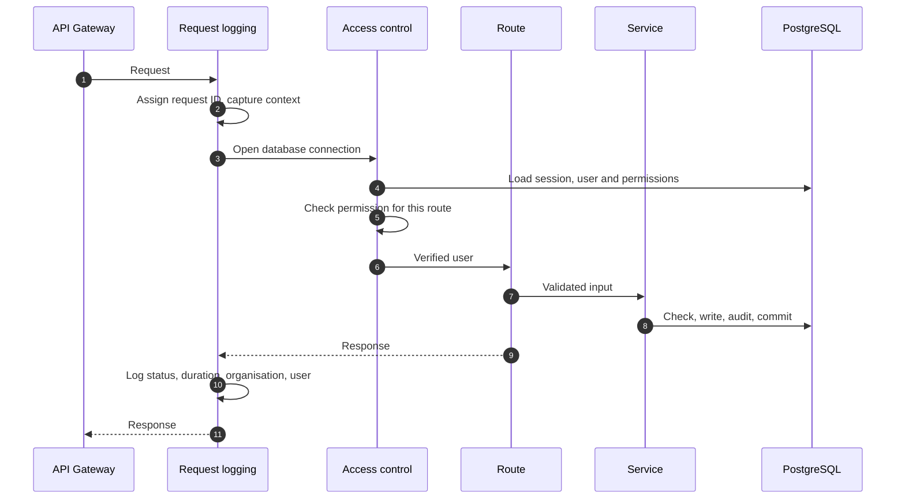
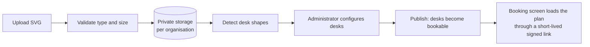

# Technical Design Highlights

## Request handling

Every API request follows the same path:

*Figure: Life of an API request.*

| Step | Detail |
|---|---|
| Identity | The session cookie is verified, the session is confirmed active, and the user and permissions are reloaded |
| Access | Route-level permission gates, plus business rules such as "only the booking owner or an administrator" |
| Validation | Every input is validated against a typed schema before any processing |
| Transaction | Business services perform all checks and writes, including the audit entry, in one transaction |
| Errors | Responses use clear, stable error codes (for example *seat taken* or *not found*) without internal details |

## Data consistency

| Mechanism | Guarantee |
|---|---|
| Single transaction per action | An action is fully applied or not at all |
| Booking slot locks | Requests for the same desk-day or person-day are handled one at a time |
| Unique database constraints | A second, independent guarantee of one booking per desk-day and person-day |
| Booking history | Changes create a linked new booking; nothing is overwritten |
| Audit within the transaction | The record of an action is saved together with the action |

## Organisation settings

Settings have a platform default and an optional organisation value. Services read the effective value when they need it, so a change made on the Configuration screen applies on the next action.

## Floor-plan pipeline

*Figure: From drawing to bookable floor.*

## Notifications

E-mails are rendered from templates (with automatic escaping of user-provided text) and sent through Amazon SES after the action completes. Temporary e-mail service hiccups are retried automatically with increasing delays. Delivery problems are logged and never affect the booking itself.

## Logging and traceability

| Signal | Content |
|---|---|
| Application log | One structured entry per request: request ID, method, path, status, duration, organisation, user |
| Gateway access log | Request ID, route, status |
| Audit log | Business actions with actor, outcome, before and after values |
| Correlation | Callers can pass a correlation ID, which appears in the logs |
