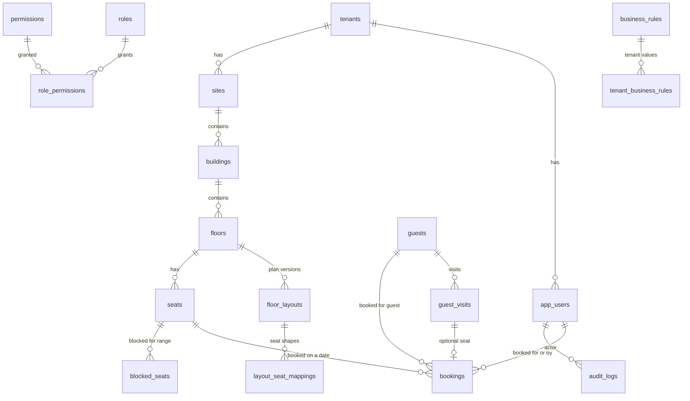
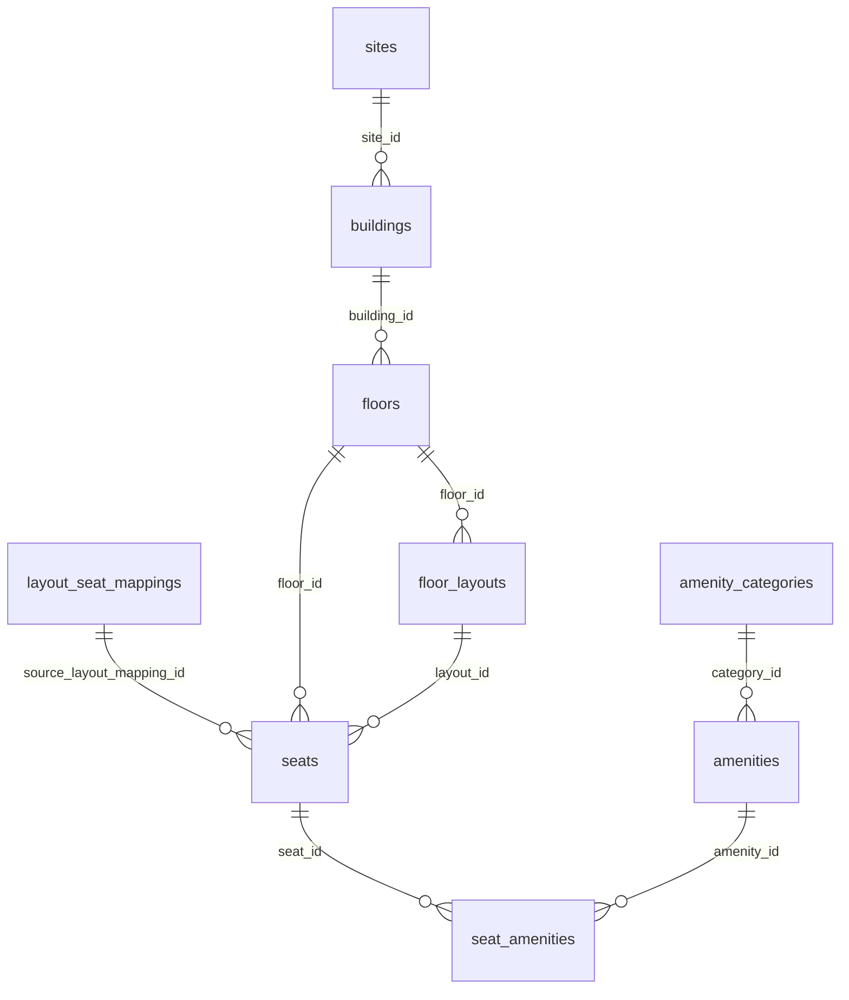
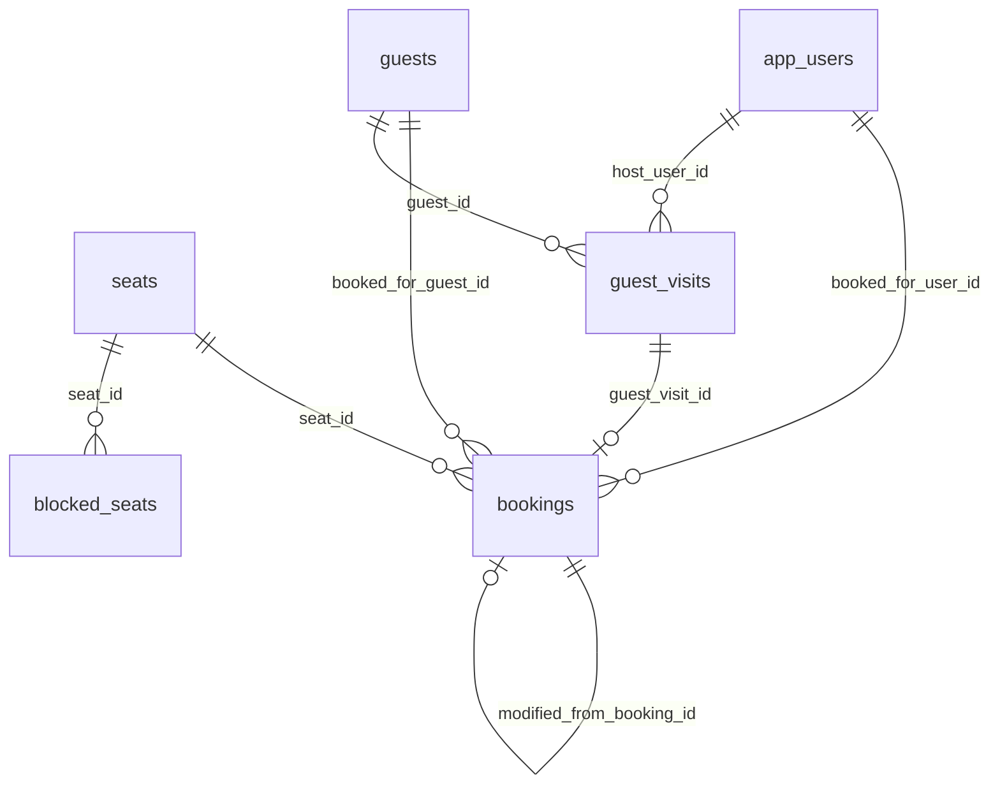

# Data Model

## Overview

SeatBook stores its data in PostgreSQL: 36 tables in four domains. Every business record carries the organisation it belongs to.

| Domain | Main tables |
|---|---|
| Identity and access | Organisations, users, identities, sessions, roles, permissions, teams |
| Locations and layouts | Sites, buildings, floors, floor layouts, desk mappings, desks, amenities |
| Bookings and visitors | Bookings, blocked seats, visitors, visits |
| Configuration and records | Business rules and organisation values, preferences, audit log, chatbot sessions and messages |

## Core model

*Figure: The core entities and how they relate.*

## Key entities

| Entity | Holds |
|---|---|
| Organisation (`tenants`) | A customer organisation and its Microsoft tenant |
| User (`app_users`) | Name, e-mail, role, status, profile |
| Site, building, floor | The location hierarchy |
| Floor layout | A version of a floor's drawing and its status |
| Desk (`seats`) | A bookable place on a published layout, with its amenities |
| Booking | One desk, one day, for an employee or a visitor, with who booked it and its status |
| Visitor (`guests`) and visit | Visitor profile and planned visits with host and status |
| Blocked seat | A desk taken out of use for a period |
| Business rule | A setting's default and each organisation's value |
| Audit log | Who did what, when, with what outcome and which changes |

## Integrity rules built into the database

| Rule | Mechanism |
|---|---|
| One active booking per desk per day | Unique index on organisation, desk and date for active bookings |
| One active booking per employee per day | Unique index on organisation, employee and date |
| One active booking per visitor per day | Unique index on organisation, visitor and date |
| One published layout per floor | Unique index on floor for published layouts |
| One planned layout per floor | Unique index on floor for scheduled layouts |
| One active visitor profile per e-mail | Unique index on organisation and lower-cased e-mail |
| Referential integrity | Foreign keys link related entities such as desks, bookings, visits and users |

## Domain diagrams

### Locations and layouts

*Figure: Locations and layouts.*

### Bookings and visitors

*Figure: Bookings and visitors.*
