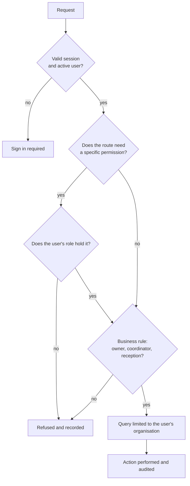

# Security and Data Protection

## Security by design

SeatBook protects access and data at several layers, from sign-in to the database.

*Figure: How every request is checked.*

## Identity and sessions

| Control | Detail |
|---|---|
| Corporate single sign-on | Microsoft Entra ID; SeatBook never stores passwords |
| Verified identity | Microsoft's signed identity token is verified; the user's organisation comes from it |
| Protected sign-in round trip | A one-time check value guards the return from Microsoft |
| Secure cookies | Session tokens are kept in HttpOnly, Secure cookies that page scripts cannot read |
| Short-lived access | Access tokens last 15 minutes and are renewed silently |
| Rotating renewal | Each renewal issues a new token; reuse of an old one ends the session |
| Server-side sessions | Sign-out, role change and deactivation end access immediately |

## Access control

| Control | Detail |
|---|---|
| Authentication on every request | All 93 non-public API endpoints require a valid session of an active user |
| Role-based permissions | Administrative functions require specific permissions held by the user's role |
| Ownership rules | Bookings can be changed only by the person they are for, the person who made them, or an administrator |
| Delegation rules | Only facilitators and administrators book for others or manage visitors |
| Separation of duties | Only front office records visitor arrivals and departures |
| Self-protection | Administrators cannot change their own access; an organisation always keeps an administrator |

## Organisation isolation

- The organisation is taken from the verified identity, never from what the browser sends.
- Every database query is limited to the user's organisation.
- Floor-plan files are stored under a separate folder per organisation.

## Protecting data

| Area | Control |
|---|---|
| In transit | HTTPS for the website and API; TLS between the API and the database |
| Network | API and database run in private network subnets; the database is not publicly reachable |
| Secrets | Database credentials and signing keys live in AWS Secrets Manager, not in code |
| Files | Private storage; files are shown through signed links that expire |
| Input | Every request is validated against a typed schema; database access uses parameterised queries |
| Output | Errors use short codes without internal details; e-mail templates escape user-provided text |
| Least privilege | The application's cloud role may only read its two secrets, store and read floor plans, and send e-mail |
| Deployment | Automated deployments use short-lived federated credentials (OIDC); no long-lived cloud keys |
| Traffic limits | The API gateway throttles excessive request rates |

## Audit and accountability

Every significant action writes an audit entry with the actor, organisation, action, item, outcome, before and after values, changed fields, request ID, IP address and browser. Successful, refused and failed actions are all recorded, giving administrators a complete picture.
