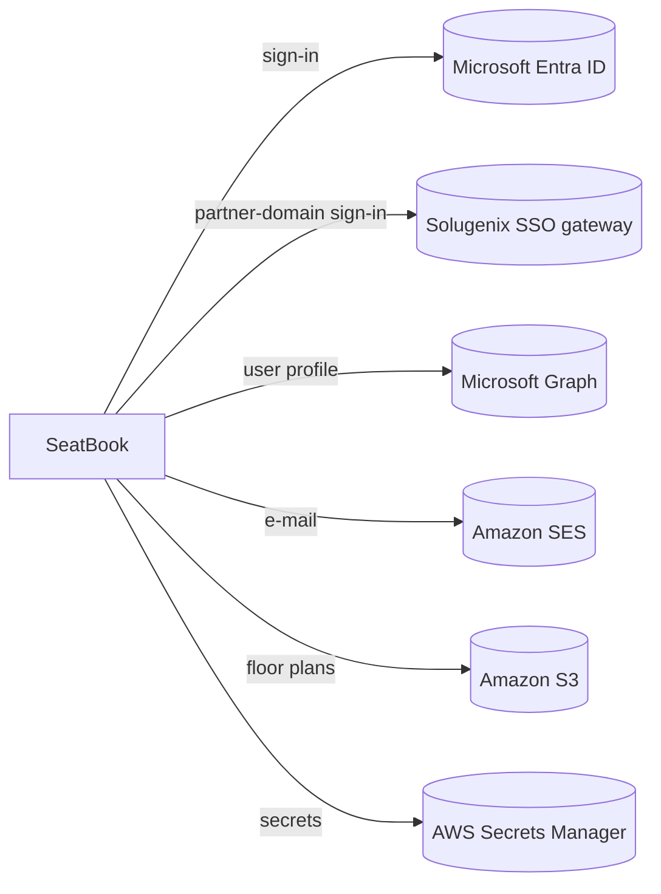

# Integrations and Notifications

## External services

*Figure: Services SeatBook works with.*

| Service | Used for |
|---|---|
| Microsoft Entra ID | Single sign-on with corporate accounts |
| Solugenix SSO gateway | Sign-in for users of the configured partner e-mail domain |
| Microsoft Graph | User profile details at sign-in |
| Amazon SES | Booking and administrative e-mails |
| Amazon S3 | Private storage of floor-plan drawings |
| AWS Secrets Manager | Credentials and keys |

## E-mail notifications

| Event | Recipients |
|---|---|
| Desk booked, changed or cancelled | The people concerned by the booking |
| Floor layout uploaded or published | All administrators of the organisation, plus any configured notification addresses |
| Seats blocked | All administrators of the organisation, plus any configured notification addresses |

E-mails are built from branded templates and sent after the action is complete. Short service interruptions are retried automatically. An e-mail problem never affects the booking itself.

## Onboarding a new organisation

1. Register the organisation's Microsoft tenant in SeatBook.
2. Users sign in with their Microsoft accounts and are created automatically.
3. An administrator sets up offices, uploads floor plans, configures desks, and assigns roles.
4. Optional: adjust business rules on the Configuration screen.
