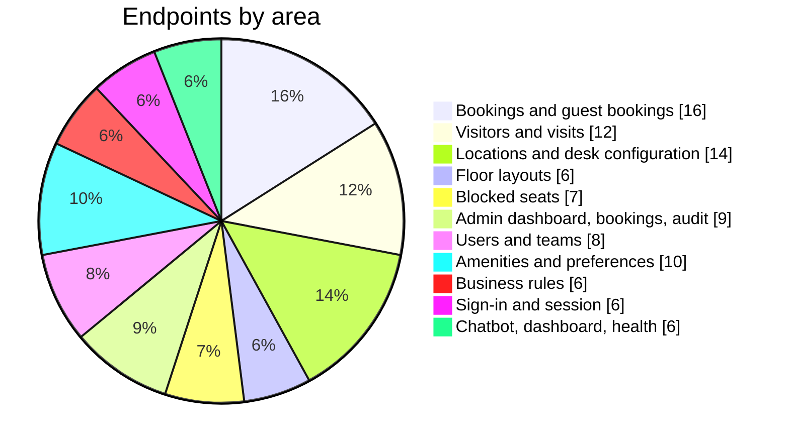

# API Overview

## Overview

The SeatBook frontend talks to one REST API with 100 endpoints. All endpoints exchange JSON over HTTPS, except floor-plan uploads, which send the file itself. Apart from sign-in, sign-out and health checks, every endpoint requires a signed-in user.

*Figure: How the 100 endpoints are distributed.*

## Endpoint groups

| Area | Endpoints | Examples |
|---|---|---|
| Sign-in and session | 6 | Start sign-in, Microsoft and gateway return, current user, renew, sign out |
| Bookings | 12 | Book, check eligibility, change, cancel; my bookings by period; bookings made for others |
| Guest bookings | 4 | List, view, change, cancel visitor desks |
| Visitors | 6 | Search, create, view and update visitor profiles; status; visit history |
| Visits | 6 | Create visits (with optional desk), list, view, check in, check out, manage |
| Offices, buildings, floors | 12 | List, create, view and update each level; desks on a floor |
| Desk configuration | 2 | Configure one desk or many desks at once |
| Floor layouts | 6 | Upload, list per floor, desks in a layout, publish, schedule, discard |
| Blocked seats | 7 | List, summary, floor resources, block, update, end, history |
| Admin bookings | 3 | Search all bookings; suggestions for people and desks |
| Admin dashboard | 4 | Summary, occupancy by date range and by location, activity |
| Audit log | 2 | Search and detail |
| Users and access | 6 | Directory, user detail and bookings, profile update, role and status change |
| Teams | 2 | My team overview, member search |
| Amenities and categories | 8 | List, create, view and update |
| Preferences | 2 | Save mine; read a colleague's (for booking on their behalf) |
| Business rules | 6 | Read each policy group; update settings |
| Employee dashboard | 1 | Personal dashboard data |
| Chatbot | 3 | Start a session, send a message, read a session |
| Service | 2 | Service banner, health check |

## Conventions

| Convention | Detail |
|---|---|
| Authentication | Secure session cookies set at sign-in |
| Data format | JSON requests and responses, validated against typed schemas |
| Errors | Standard HTTP status codes with a body of `{"detail": {"code", "message"}}` |
| Status codes | 200/201 success; 400 rule not met; 401 sign-in required; 403 not allowed; 404 not found; 409 conflict (for example desk taken); 422 invalid input |
| Pagination | `page` and `limit` parameters on large lists |
| Tracing | Optional `X-Correlation-ID` header appears in the logs |

Field-level descriptions are generated from the code as an OpenAPI specification for development teams.
