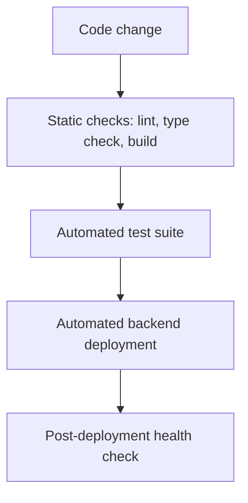
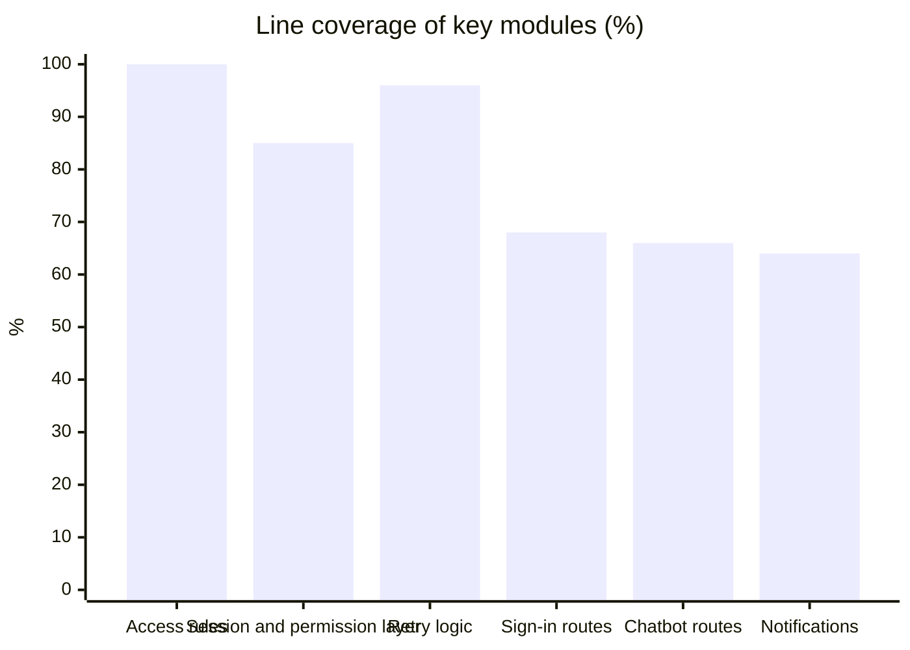

# Quality Assurance

## Approach

Every backend and frontend change is checked automatically. Backend deployment proceeds only after the full test suite passes, and each deployment ends with a health check.

*Figure: Quality gates on the way to production.*

## Automated tests

| Layer | What it verifies |
|---|---|
| Access rules | Every ownership, delegation and reception rule, line by line |
| API boundary | All 100 endpoints: sign-in is required where it should be, and each permission-protected endpoint refuses users without the permission |
| Sign-in | Microsoft and gateway sign-in paths, including rejected and tampered sign-in attempts |
| Booking logic | Booking, changing and cancelling, conflicts, blocked desks, delegation, history |
| Visitors | Visitor profiles, visits, reception check-in and check-out |
| Floor plans and seats | Upload validation, layout lifecycle, desk configuration |
| Blocked seats | Blocking rules and list performance |
| Configuration | Validation of every business-rule setting |
| Notifications | E-mail delivery and retry behaviour when the e-mail service is slow or unavailable |
| Concurrency | Booking locks are taken before any availability check; a database-level suite for simultaneous bookings of the same desk is included |

## Results

| Measure | Result |
|---|---|
| Automated backend tests passing | 438 |
| Endpoints covered by access tests | 100 of 100 |
| Access-rule module line coverage | 100% |
| Fault-injection check of access rules | 5 of 5 injected faults detected by the tests |
| Python static analysis (ruff) | No findings |
| Frontend type check | No errors |
| Database queries | All parameterised; dynamic parts drawn from fixed lists |

*Figure: Coverage of the most security-relevant modules.*
