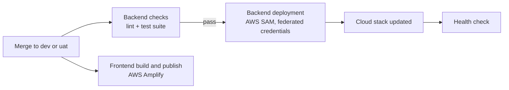

# Deployment and Operations

## Environments

| Environment | Purpose | Delivery |
|---|---|---|
| dev | Development and integration | Automatic on merge to the `dev` branch |
| uat | User acceptance testing | Automatic on merge to the `uat` branch |
| qa, prod | Quality assurance and production | Supported by the same infrastructure template |

Each environment is a separate, identically defined cloud stack.

## Delivery pipeline

*Figure: Automated delivery.*

| Step | Detail |
|---|---|
| Infrastructure as code | The API, function, permissions and logs are defined in one AWS SAM template |
| Backend checks | Linting and the automated test suite run on every backend change |
| Backend deployment | Builds in a clean container and deploys with short-lived federated credentials |
| Health check | The pipeline calls the health endpoint after each deployment |
| Frontend | AWS Amplify builds and publishes the Next.js application per branch |

## Runtime profile

| Setting | Value |
|---|---|
| Compute | AWS Lambda, Python 3.14, 1,024 MB memory |
| Request limit | 30 seconds per request |
| Concurrency | Capped (default 10) to keep database load predictable |
| API throttling | 50 requests per second sustained, bursts of 100 |
| Network | Private subnets for the API and database |
| Logs | Kept for a configurable period (default 30 days) |

## Configuration

All environment-specific values (database name, Microsoft application, frontend address, storage bucket, e-mail sender, token lifetimes) are deployment parameters. Secrets are held in AWS Secrets Manager and read at start-up. Nothing environment-specific is built into the code.

## Monitoring

| Source | What it shows |
|---|---|
| Application logs (CloudWatch) | One structured entry per request with request ID, status, duration, organisation and user |
| API gateway access logs | Every request reaching the API, with route and status |
| Health endpoint | Service availability |
| Audit log | Business activity, visible to administrators in the application |

## Support quick reference

| Question | Where to look |
|---|---|
| Was a request received and how long did it take? | Application log, by request ID or user |
| Who changed a booking or setting? | Audit log in the administrator screens |
| Is the service up? | Health endpoint |
| Why can a user not see an admin screen? | Their role on the Users screen |
